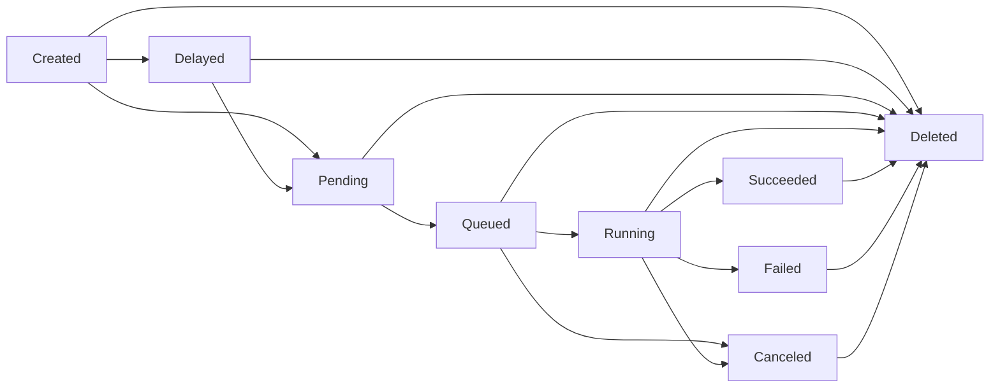

# Job States

Complete reference for job states and lifecycle in Min iJob Admin Dashboard.

## Job Lifecycle Overview



## State Definitions

### Created

**Description:** Initial state when a job is first created.

**Characteristics:**

- Job exists in database
- Not yet queued for processing
- Waiting to be picked up by scheduler

**Next States:**

- → Delayed (if `start_after` is set)
- → Pending (if dependencies exist)
- → Queued (if ready immediately)
- → Deleted (if manually removed)

**Typical Duration:** < 1 second

**Actions Available:**

- View details
- Clone
- Delete
- Cancel

---

### Delayed

**Description:** Job is scheduled to start at a future time.

**Characteristics:**

- Has `start_after` timestamp in the future
- Will transition to Pending/Queued when time arrives
- Visible in system but not processed yet

**Next States:**

- → Pending (when time arrives, if dependencies)
- → Queued (when time arrives and ready)
- → Canceled (if manually stopped)
- → Deleted (if removed)

**Typical Duration:** Variable (seconds to days)

**Common Use Cases:**

- Scheduled reports
- Delayed notifications
- Timed workflows

**Actions Available:**

- View details
- Clone
- Modify schedule (if supported)
- Cancel
- Delete

---

### Pending

**Description:** Job is waiting for dependencies or conditions to be met.

**Characteristics:**

- All prerequisites not yet satisfied
- Could be waiting for:
  - Dependent jobs to complete
  - Resources to become available
  - External conditions
- Not yet eligible for worker pickup

**Next States:**

- → Queued (when all conditions met)
- → Canceled (if manually stopped)
- → Deleted (if removed)

**Typical Duration:** Variable (seconds to hours)

**Monitoring:**

- Check for stuck pending jobs
- Verify dependencies are completing
- Ensure conditions can be met

**Actions Available:**

- View details
- Clone
- Cancel
- Delete

---

### Queued

**Description:** Job is ready and waiting for an available worker.

**Characteristics:**

- All dependencies satisfied
- Resources available (or will be locked)
- In queue for worker pickup
- Will be processed ASAP based on priority

**Next States:**

- → Running (when worker picks it up)
- → Canceled (if manually stopped)
- → Deleted (if removed)

**Typical Duration:** Seconds to minutes (depends on queue depth and worker availability)

**Priority Impact:**

- Priority 3 jobs processed first
- Priority 0 jobs processed last
- Same priority: FIFO order

**Actions Available:**

- View details
- Clone
- Cancel (before start)
- Delete

---

### Running

**Description:** Job is currently being processed by a worker.

**Characteristics:**

- Worker actively executing job logic
- Resources locked (if specified)
- Progress may be tracked
- Has start timestamp

**Next States:**

- → Succeeded (on successful completion)
- → Failed (on error or exception)
- → Canceled (if manually stopped mid-execution)
- → Deleted (force deleted, not recommended)

**Typical Duration:** Variable (seconds to hours, depends on job type)

**Monitoring:**

- Track execution time
- Identify stalled jobs
- Monitor resource locks

**Stalled Job Detection:**
A running job is considered "stalled" if:

- Duration exceeds expected execution time (typically > 1 hour)
- No heartbeat/progress updates received
- Resources held but no activity

**Actions Available:**

- View real-time details
- Clone (for retry)
- Cancel (graceful stop, if supported)
- Force cancel
- Monitor logs

---

### Succeeded

**Description:** Job completed successfully.

**Characteristics:**

- Job logic executed without errors
- All expected outputs produced
- Resources released
- Has completion timestamp
- Duration recorded

**Terminal State:** Yes (no further transitions except deletion)

**Metrics:**

- Contributes to success rate
- Duration used in average calculations
- May trigger dependent jobs

**Typical Duration:** Permanent (until manually deleted or auto-purged)

**Common Post-Actions:**

- Review results
- Clone for similar jobs
- Archive or delete old jobs

**Actions Available:**

- View details
- Clone
- Delete
- Export results (if applicable)

---

### Failed

**Description:** Job encountered an error and did not complete successfully.

**Characteristics:**

- Exception or error occurred during execution
- May have partial results
- Error message/stack trace recorded
- Resources released
- Has completion timestamp

**Terminal State:** Yes (no further transitions except deletion)

**Next Actions:**

- → Can be manually retried (creates new job)
- → Deleted (cleanup)

**Common Failure Reasons:**

- Invalid input data
- Network timeout
- External service unavailable
- Database error
- Resource exhaustion
- Logic error/exception
- Timeout exceeded

**Investigation:**

1. Check error message/stack trace
2. Review job properties
3. Check resource availability
4. Verify external dependencies
5. Review worker logs

**Actions Available:**

- View details (including error)
- Retry (creates new job)
- Clone with modifications
- Delete

---

### Canceled

**Description:** Job was manually stopped before or during execution.

**Characteristics:**

- User-initiated termination
- May have partial execution
- Resources released
- Has cancellation timestamp
- Cancellation reason may be recorded

**Terminal State:** Yes (no further transitions except deletion)

**When to Cancel:**

- Job processing wrong data
- Need to deploy fix
- Job taking too long
- Resource conflict
- Testing/development cleanup

**Side Effects:**

- Cancellation doesn't rollback changes
- Partial work may be committed
- Handle cleanup in job implementation

**Actions Available:**

- View details
- Retry (if issue resolved)
- Clone with fixes
- Delete

---

### Deleted

**Description:** Job removed from the system (soft or hard delete).

**Characteristics:**

- No longer visible in main views
- May be archived or permanently removed
- Resources freed
- History may be retained

**Terminal State:** Yes (permanent)

**When Jobs Are Deleted:**

- Manual deletion by user
- Automatic cleanup (retention policy)
- System maintenance
- Bulk operations

**Data Retention:**

- Depends on system configuration
- May be soft delete (flagged)
- May be hard delete (removed from DB)

**Cannot Be:**

- Viewed (unless archived)
- Retried
- Cloned (unless archive accessible)

---

## State Transitions

### Valid Transitions

| From              | To        | Trigger                     |
| ----------------- | --------- | --------------------------- |
| Created           | Delayed   | `start_after` set           |
| Created           | Pending   | Dependencies exist          |
| Created           | Queued    | Ready immediately           |
| Delayed           | Pending   | Time arrived + dependencies |
| Delayed           | Queued    | Time arrived                |
| Pending           | Queued    | Dependencies met            |
| Queued            | Running   | Worker pickup               |
| Running           | Succeeded | Successful completion       |
| Running           | Failed    | Error occurred              |
| Running           | Canceled  | Manual cancellation         |
| Any               | Deleted   | Manual deletion             |
| Any (not Running) | Canceled  | Manual cancellation         |

### Invalid Transitions

- Succeeded → Running (cannot restart, must retry/create new)
- Failed → Running (cannot restart, must retry/create new)
- Deleted → any (permanent removal)
- Queued → Succeeded (must run first)

## State Colors

UI color coding:

| State     | Color      | Reasoning               |
| --------- | ---------- | ----------------------- |
| Created   | Light Gray | Neutral, new            |
| Delayed   | Yellow     | Notice, scheduled       |
| Pending   | Orange     | Attention, waiting      |
| Queued    | Light Blue | Info, ready             |
| Running   | Blue       | Active, in progress     |
| Succeeded | Green      | Success, completed      |
| Failed    | Red        | Error, attention needed |
| Canceled  | Gray       | Neutral, stopped        |
| Deleted   | Dark Red   | Removed                 |

## State Filtering

### Common Filters

**Active Jobs:**

```
state IN (Queued, Running)
```

**Completed Jobs:**

```
state IN (Succeeded, Failed, Canceled)
```

**Problem Jobs:**

```
state IN (Failed, Stalled-Running)
```

**Scheduled Jobs:**

```
state = Delayed
```

**Waiting Jobs:**

```
state IN (Pending, Queued)
```

## State Metrics

### Success Rate Calculation

```
Success Rate = Succeeded / (Succeeded + Failed) × 100%
```

Excludes: Created, Delayed, Pending, Queued, Running, Canceled, Deleted

### Completion Rate

```
Completion Rate = (Succeeded + Failed) / Total × 100%
```

### Active Workload

```
Active = Queued + Running
```

## Best Practices

### Monitoring

1. **Watch for stuck jobs:**
   - Long-running jobs
   - Growing Pending queue
   - Stalled Running jobs

2. **Track failure patterns:**
   - Which topics fail most
   - Common error messages
   - Time-based patterns

3. **Capacity planning:**
   - Monitor Queued depth
   - Track average duration
   - Identify bottlenecks

### Job Lifecycle Management

1. **Set realistic timeouts:**
   - Based on expected duration
   - Add buffer for variance
   - Consider resource contention

2. **Handle failures gracefully:**
   - Implement retry logic
   - Log detailed errors
   - Clean up resources

3. **Clean up completed jobs:**
   - Set retention policy
   - Archive important results
   - Delete old test jobs

## API Integration

### Get Job State

```javascript
GET /api/jobs/:id

Response:
{
  "id": "job-123",
  "state": "running",
  "state_changed_at": "2026-02-08T10:30:00Z",
  "elapsed_time": 45,  // seconds
  ...
}
```

### Filter by State

```javascript
GET /api/jobs?state=failed&limit=50

Response:
{
  "jobs": [...],
  "total": 150,
  "page": 1
}
```

### State History

```javascript
GET /api/jobs/:id/history

Response:
{
  "history": [
    { "state": "created", "timestamp": "2026-02-08T10:00:00Z" },
    { "state": "queued", "timestamp": "2026-02-08T10:00:05Z" },
    { "state": "running", "timestamp": "2026-02-08T10:00:10Z" },
    { "state": "succeeded", "timestamp": "2026-02-08T10:05:30Z" }
  ]
}
```

## Next Steps

- **[Jobs Management](/guide/features/jobs)** - Managing jobs in different states
- **[API Reference](/reference/api)** - Complete API documentation
- **[Dashboard](/guide/features/dashboard)** - Monitoring job states
